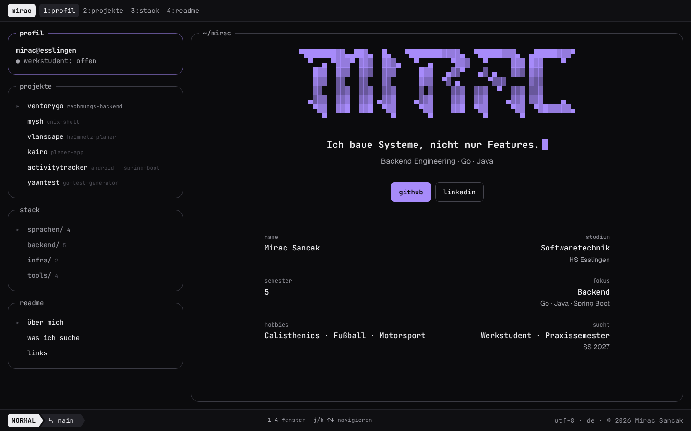

# mirac@esslingen ~ portfolio

Meine Portfolio-Seite im Stil eines Terminals mit tmux, lazygit und neofetch als Vorbild. Die Seite zeigt Profil, Projekte, Stack und ein kurzes Readme. Die Commit-Historie und die Codezeilen kommen direkt aus meinen lokalen Repos.

<!-- Screenshot: Bild als docs/screenshot.png ablegen und in der nächsten Zeile die Kommentarzeichen entfernen -->
<!-- <p align="center"></p> -->

**Gebaut mit** React 19, TypeScript und Vite. Keine UI-Bibliothek, das gesamte Styling steckt in `src/App.css`.

## Lokal starten

```bash
npm install
npm run dev       # http://localhost:5173
npm run build     # Typecheck und Build nach dist/
npm run lint
```

## Inhalte ändern

Alle Texte stehen in **`src/content.ts`**. Für Inhaltsänderungen muss keine andere Datei angefasst werden.

| Was | Wo in `content.ts` |
|---|---|
| Überschrift, Fakten, Status „werkstudent: offen“ | `profile` |
| Mail, GitHub, LinkedIn | `profile.links` |
| Projekte | `projects.items` |
| Technologien | `stack.groups` |
| Texte im Readme-Fenster | `readme.sections` |
| Statuszeile unten | `footer` |

Ein leerer String (`''`) blendet das Feld aus. Das gilt für Links, den Projektstatus und die Repo-URL. Der erste sichtbare Link erscheint auf der Startseite als lila Button.

### Projekt hinzufügen

1. Einen Eintrag in `projects.items` anlegen. Die `id` ist kurz und kleingeschrieben, sie erscheint in der Liste und in der Adresszeile.
2. Ein Bild oder Video nach `public/media/` legen und unter `media.src` eintragen, z.B. `/media/meinprojekt.webp`. Ohne `media` bleibt die Bildfläche weg.
3. Optional die Git-Daten neu erzeugen (siehe unten). Das Skript findet das Repo über die `id`, der Ordnername muss also bis auf Groß- und Kleinschreibung gleich sein.

Bilder am besten als `.webp` im Format 16:10 ablegen. Sie werden auf dieses Format zugeschnitten, oben links bleibt immer sichtbar.

### Readme-Abschnitt hinzufügen

Einen Eintrag in `readme.sections` anlegen, entweder mit `paragraphs` für Fließtext oder mit `list` für Stichpunkte. Der Abschnitt erscheint automatisch auch in der Seitenleiste.

## Git-Daten aktualisieren

```bash
node scripts/git-stats.mjs              # liest ~/code/personal
node scripts/git-stats.mjs ~/anderer/ordner
```

Das Skript schreibt `src/data/git.json`. Darin stehen die Commit-Heatmap der letzten 26 Wochen, die Codezeilen pro Sprache und das Git-Log pro Projekt. Im Log landen nur `feat`, `fix`, `refactor` und `perf`, damit dort keine Chore-Commits stehen.

## Vorschaubild und Screenshots

Titel und Beschreibung für Google und Link-Vorschauen stehen in `index.html`. Das Vorschaubild `public/og.png` wird bei laufendem Dev-Server so neu erzeugt:

```bash
node scripts/og-shot.mjs
```

Für einen Abgleich nach Designänderungen erzeugt `node scripts/shots.mjs shots/neu` alle Fenster in Hell und Dunkel, jeweils für Desktop und Handy.

## Tastenkürzel

| Taste | Aktion |
|---|---|
| `0` bis `3` | Fenster wechseln |
| `j` / `k` | Auswahl in Projekte und Stack |
| `t` | helles oder dunkles Design |

## Aufbau

```
src/
├── content.ts      alle Texte
├── types.ts        Form der Inhalte
├── App.tsx         Fenster, Tastenkürzel, Layout
├── App.css         Farben, Abstände, Responsive
├── components/     ein Fenster pro Datei, dazu Banner, Heatmap und Liste
└── data/git.json   erzeugt von scripts/git-stats.mjs
```

Farben und Typografie folgen `DESIGN.md`.
